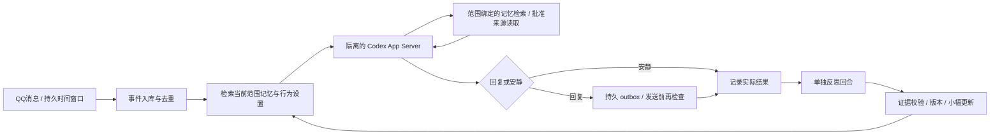

# Codex QQ Character Plugin · 汐

**用于部署和管理持续 QQ 角色的 Codex 插件。** 本仓库同时提供插件包、Python 常驻桥接器、独立 Codex Docker 环境和 NapCat 部署配置。插件负责管理流程；QQ 在线依赖桥接器、NapCat 和 Codex 容器持续运行。

**换电脑，从空记忆开始：**直接阅读 [Windows 10/11 全新部署](docs/windows-fresh-install.md)。其中包含可复制给新 Codex 聊天的部署提示。插件安装见 [管理插件说明](plugins/qq-character/README.md)。本项目是社区项目，并非 OpenAI 或腾讯官方插件。

这是一个可运行的最小成长闭环原型：**复用 qq-codex-companion 的 MIT OneBot 网络层，新增有证据、有范围的记忆与调度核心，通过官方 Codex App Server 运行角色。** 不使用通用聊天 API 冒充 Codex，不修改模型权重。

初始角色叫“汐”，使用自然简体中文，背景明确标为虚构。默认使用 NapCat/OneBot 独立 QQ 测试账号、从空记忆开始。身份、背景、价值观、初始兴趣与表达风格在 `config/example.json` 的 `identity`，部署后编辑 `config/local.json`。

**验证范围：**发布前重新执行离线测试；开发实例曾完成独立 Docker 登录、实际 `gpt-6.1-sol / medium` 推理和真实 QQ 收发。新电脑必须重新登录并验收。`demo` 使用 MockRuntime，不代表全部成长能力已通过真实验收。见 [公开验证摘要](docs/deployment-2026-10-26.md) 和 [逐项验收边界](docs/acceptance.md)。公开仓库不含聊天记录、账号白名单、二维码、Token 或登录状态。

## 为什么选这个基础

对六个项目均核查了当前代码、固定 SHA、许可证与维护信号。主参考 dsh-bili-whale 的持久时间窗、活动记录、真实反馈影响后续排序值得保留；其 DSH 私有会话接口、全权限执行、全量日记恢复、把沉默情绪化、用生成日记补证据不适用这里。

qq-codex-companion 轻量、MIT，已有 App Server 和 OneBot。直接保留其 WebSocket 鉴权、连接更替、echo 回执网络基础；覆盖只有内存去重和私聊的事件处理，并替换全局记忆/环境继承。其他项目的实际能力、许可证和不选原因都有源码链接，未简单以 README 定论：

- [主参考行为审计](docs/reference-whale.md)
- [五个基础项目与官方 QQ / NapCat 比较](docs/reference-foundations.md)
- [第三方来源说明](THIRD_PARTY_NOTICES.md)

## 最小闭环



身份不是每句回复的脚本。每轮模型得到当前身份、少量相关记忆、近期真实事件、个体表达设置和批准来源，可以使用工具、提出小幅调整、回复或不回复。每轮新建 ephemeral Codex thread，长期连续性来自宿主持久数据，不依赖无限增长的模型会话。聊天、反思、开发的日志不会直接送到 QQ；只有通过结构检查的最终 `reply` 可以进 outbox。

反思发生在行动结果已记录之后。首次结果是 `queued` 或 `quiet`，不能把入队当成已送达；最终发送成功/失败回执进入证据，在后续回合再次检索。日记是可选的简短叙事字段，结构化反思记录变更与拒绝原因，均不是隐藏推理链，也不是事实来源。

## 记忆如何真正影响后续行为

| 类别 | 存储 / 约束 | 后续作用 |
|---|---|---|
| 实际经历 | episodic，绑定原始消息或读取证据 | 找回共享事件，避免虚构细节 |
| 来源支持的知识 | knowledge，必须有真实 source 证据 | 带出处回答、继续探索；“有来源”不等于事实绝对正确 |
| 个体观察 | user_observation，范围+本人标识 | 不把一个人的表达当成所有人的偏好 |
| 偏好与兴趣 | preference / versioned behavior，置信度、证据 | 改变长度/提问倾向；阅读后可每天小幅新增兴趣 |
| 临时状态 | 最近 6 条消息、队列状态、取消 epoch | 接续当前对话，处理顺序与中断 |
| 行为教训 | lesson，引用原始证据 | 后续检索并应用，支持纠正与回滚 |

所有耐久记忆带 scope、时间、confidence、evidence IDs、到期时间。私聊和不同群完全分开；不会把私聊反思提升为全局角色技能。单次偏好观察置信度上限 0.55，普通知识/记忆上限 0.85；这些是工程保守参数，不是统计校准概率。明确“短一点”等反馈才允许更新对应低风险表达设置，未知键、跨范围证据、反思自证会被拒绝。

检索采用中文双字片段与词项匹配，最多返回 8 条，不注入整个档案。此最小版只在最近 200 个有效候选中排序，适合小规模验证；大规模使用应换全文索引或向量检索。整合包括同 key 纠正取代、相同证据去重、过期清理和旧版本压缩，不声称已实现语义级知识库合并。

## 本机先运行离线验收

在本项目根目录的 PowerShell 中：

```powershell
python -m venv .venv
# 新环境先安装：
.\.venv\Scripts\python.exe -m pip install -e .
# 若 pip 索引解析很慢，可用固定版本、校验 PyPI SHA256 的安装器：
# .\.venv\Scripts\python.exe scripts\install-deps.py

.\.venv\Scripts\python.exe -m qq_character demo
.\.venv\Scripts\python.exe -m unittest discover -s tests -v
.\.venv\Scripts\python.exe -m qq_character local-probe
.\.venv\Scripts\python.exe -m qq_character doctor
```

`demo` 创建临时数据库，真实关闭/重开它，演示纠正、记住事件、隔离、安静、兴趣新增和回滚；模型与资料均为测试夹具。`local-probe` 不使用现有登录，只检查实际 App Server 发现；`doctor` 不进行推理，未配置时返回退出码 2 是预期的阻断结果。

目前使用源码 checkout + editable 安装。OneBot 子类从固定 vendor 路径加载上游两个模块，**不要仅复制 `src/` 或将这个原型当作独立 wheel 发布**。

## 启用真实 Codex 和 QQ

1. 按 [Codex 运行时部署](docs/codex-runtime.md) 构建独立 Docker 容器，在容器内单独登录 Codex，固定 image ID，检查有效技能/插件/MCP/配置来源。不要复制平时的 auth、skills、MCP 配置或私人资料。现有 Superpowers 等环境不作修改。
2. 运行初始化，编辑角色与接收范围：

```powershell
.\.venv\Scripts\python.exe -m qq_character init
notepad config/local.json
```

填写 `transport.bot_id`（测试小号）和 `allowed_private`（允许私聊者）；需要群时填写 `allowed_groups`。所有 ID 用字符串。群聊只在同一条消息显式 @ 测试账号时入队；附件只记录占位，不读取本地路径或附件链接。

3. 在 NapCat 给该测试账号添加 **OneBot 11 反向 WebSocket / Universal**：Docker Desktop 容器内使用 `ws://host.docker.internal:6198/onebot`；与桥同宿主运行的非容器客户端使用 `ws://127.0.0.1:6198/onebot`。配置独立的强 Token。桥接器要求 Bearer 鉴权头、匹配的 `X-Self-ID`、`X-Client-Role: Universal`；不接受 URL query Token。新电脑推荐按部署指南用初始化脚本生成凭据。不要抢占已有 AstrBot 的端口或账号会话。
4. 在运行桥接器的终端里设置同一个 Token，使用密码输入，避免写进命令历史或贴到对话：

```powershell
$qqSecret = Read-Host 'OneBot Token' -AsSecureString
$env:QQ_CHARACTER_ONEBOT_TOKEN = [System.Net.NetworkCredential]::new('', $qqSecret).Password
.\.venv\Scripts\python.exe -m qq_character doctor
# 只有 bridge_ready=true 再启动；CLI 也会强制检查。
.\.venv\Scripts\python.exe -m qq_character serve
```

`serve` 是前台常驻服务。NTQQ/NapCat、桥接器、Codex 容器需持续可用；关闭 Codex 桌面聊天不会替你托管这个服务。Ctrl+C 停止桥接器，数据保留。系统自启未自动安装，正式部署可让受控服务管理器监督同一命令；进程锁会拒绝双开。

## 默认节奏和预算

| 设置 | 初始值 |
|---|---|
| 自主活动 | 待指定 scope 后开启；默认关闭 |
| 活动窗口 | Asia/Shanghai 11:30、19:30，各 20 分钟；错过不补发 |
| 安静时段 | 22:00–08:00，不进行自主活动或自主发送；主动收到的聊天仍可回答 |
| 最近互动冷却 | 45 分钟 |
| 每日自主分享 | 最多 1 条；`allow_sharing` 默认 false，允许探索但不打扰 |
| 每次模型动作 | 75 秒、24000 token 监测目标（包含输入上下文和工具往返）、最多 2 次宿主动态工具调用 |
| 每个体验事件 | 最多两个模型动作：行动+反思 |
| 全角色每日回复 | 最多 100 条，按 Asia/Shanghai 自然日；跨会话共享，重启或删除会话不会重置已尝试发送额度 |
| 全角色每日总预算 | 5280000 token 预留、220 次模型调用，失败也占预算 |
| 回复有效期/发送间隔 | 300 秒 / 至少 3 秒 |

用户要求每天支持 100 次回复，因此按 100 次对话、100 次反思及 20 次诊断/维护调用配置容量。实际能否达到仍取决于账号额度、调用耗时和每次实际用量；这是上限，不是必须花完的目标。聊天和自主活动共用预算。token 用量通知与中断有延迟，可能超过单轮目标；不能把它宣传成服务端精确扣费硬上限。时间、调用次数和宿主工具次数分别约束。Codex仍可能注册部分内建工具，它们受只读沙箱和时间/token约束，不能将“两个宿主工具”误称为完整工具清单。预算只能由持有者本地配置改变。

启用自主活动时，将完整 scope 如 `onebot:测试账号:private:允许用户` 填入 `autonomy.scopes` 并设 `enabled=true`；必须是传输允许范围的子集。先保持 `allow_sharing=false` 验证实际探索和静默，再决定是否允许分享。角色可选择不调用工具、不更新、不发消息。

## 运行与数据边界

- 唯一事件 ID 包含 bot、私聊/群、会话 ID 和消息 ID，SQLite 持久去重。任务按事件发生时间排序；已处理新消息后才到达的旧消息记为 late，不自动回复。并不声称恢复了上游未提供的严格全局消息顺序。
- 普通新消息顺序排队；同一范围内 `/stop` 明确取消当前与待处理任务，后续新消息仍可交流。取消一条已经在网络发送的消息无法撤回。
- 尚未发送且已知断线时可退避重试；发送后回执丢失或重启中断标记 uncertain，停止自动重发。OneBot 没有恰好一次发送保证，此处优先避免重复打扰。过期消息丢弃，不借“主动消息”补发。
- 知识读取只允许配置中的 HTTPS 资料 ID；宿主验证公共 IP、固定已验证地址、限制大小/超时，不跟随重定向。网页和记忆无法指定新 URL、账户、收件人或运行权限。
- 模型不持有 QQ Token，不挂载 SQLite，也没有管理 CLI。只收到当前范围的检索结果。管理操作在本地进行；群内一句“打开全部权限”只是数据。
- 删除整个 scope 同时删除原始内容、记忆、行为版本、日记、outbox 和该范围技能实验；保留无内容的预算账和删除时间界限，拒绝旧事件重放。导出的备份文件不会被自动删除。
- `forget --memory` 只删除该条派生记忆，**不等于删除原始事件**；彻底删除会话内容请用整个 scope 删除。先停 bridge，导出/删除操作只由持有者选择范围。

管理命令、开发候选、测试与回滚见 [自我改进说明](docs/self-improvement.md)；插件包在 `plugins/qq-character`，有独立说明。插件只包装管理工作流，不承诺后台常驻，也没有自动安装进你的正常环境。

## 下一次真实验收的最小步骤

在独立环境登录并让 `doctor` 通过后，按 [验收矩阵](docs/acceptance.md) 的八项用例逐项执行。每项需要同时保留 QQ 消息、数据库事件/变更、实际 Codex 完成状态；尤其“有来源的自主发现”和“闲聊未触发开发技能”不能用 MockRuntime 的确定性分支代替。
